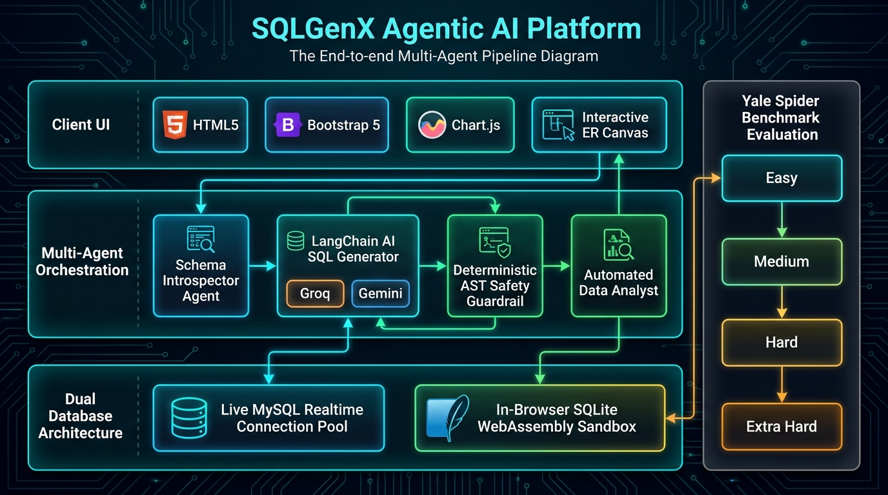

# SQLGenX: Agentic AI SQL Analytics & Interactive ER Intelligence



[](SYSTEM_ARCHITECTURE.md)
[](https://developer.mozilla.org/en-US/docs/Web/JavaScript)
[](server.js)
[](https://sql.js.org/)
[](SPIDER_DATASET.md)

**SQLGenX** is an enterprise-grade **Agentic AI SQL Generation, Data Analytics, and Entity-Relationship (ER) Intelligence Platform** built with **HTML5, CSS3, Vanilla ES6 JavaScript, LangChain JS, and Bootstrap 5.3**.

It converts natural language questions into accurate, validated SQL queries with dialect targeting (MySQL & SQLite), executes them with sub-millisecond latency, visualizes complete entity relationships in an **interactive canvas graph engine** with auto-anchored flow connectors, and renders dynamic analytics using **Chart.js**.

---

## 📚 Technical Documentation

- 🏛️ **[SYSTEM_ARCHITECTURE.md](SYSTEM_ARCHITECTURE.md)**: Full end-to-end system architecture, multi-agent sequence diagrams, dual database engine specifications, and ER canvas engine internals.
- 🕷️ **[SPIDER_DATASET.md](SPIDER_DATASET.md)**: Yale University Spider text-to-SQL benchmark guide, schema breakdowns, and difficulty tier classification (*Easy*, *Medium*, *Hard*, *Extra Hard*).

---

## ✨ Key Platform Features

### 1. Dual-Mode Database Engine
- 🐬 **Realtime MySQL Connection Bridge**: Connect directly to your local or remote MySQL server (`host`, `port`, `user`, `password`, `database`). Introspects live production schemas and executes safe read-only analytical queries over an Express connection pool.
- ⚡ **Sample Enterprise Database (Offline Sandbox)**: An in-browser SQLite database running on WebAssembly (`sql.js`) with 1,900+ seeded records across `customers`, `orders`, `order_items`, `products`, `categories`, and `payments`. Ready immediately out of the box with zero setup required.

### 2. Interactive Canvas ER Visualizer Engine
- 🕸️ **Pan & Zoom Navigation**: Smooth mouse wheel zooming (centered at mouse coordinates) and click-and-drag canvas panning with `grabbing` cursor.
- 📐 **Edge-to-Edge Bezier Auto-Anchors**: Connectors anchor directly to card borders with directional arrowheads, preventing connector lines from cutting through card text.
- ⚡ **Animated Marching Dash Flow**: Selecting a table activates animated marching dashes along related foreign key paths to visually demonstrate relationship flow (`PK ──► FK`).
- 🔍 **Table Search in Diagram**: Real-time search filter that highlights matching tables and smoothly auto-centers the viewport on them.
- 🎛️ **Interactive Toolbar**: Dedicated buttons for `Fit to Screen`, `Zoom In`, `Zoom Out`, `100% Reset`, `Auto-Rearrange`, and `Fullscreen`.
- 👁️ **Double-Click Record Preview**: Double-clicking any table node on the canvas instantly opens the live table data preview modal (10 sample rows) directly from the diagram.
- 📋 **Tabular Schema Inspector & Cardinality Matrix**: Tabular cards detailing all column data types, primary keys (`PK`), and foreign keys (`FK`), alongside a whole-database relationship matrix.

### 3. Multi-Agent AI Query Copilot
- 🤖 **LangChain AI Model Routing**: Connects to **Groq Cloud** (LLaMA 3.3, GPT-OSS 120B), **Google Gemini** (1.5 Flash), and **OpenAI** (GPT-4o).
- 🔌 **Offline Semantic Fallback**: Intelligent rule-based engine providing instant offline SQL query generation without requiring an API key.
- 🛡️ **Deterministic AST Safety Guardrail**: Client-side AST scanner that computes risk scores (**LOW**, **MEDIUM**, **HIGH**) and strictly blocks mutating operations (`DROP`, `DELETE`, `TRUNCATE`, `ALTER`, `CREATE`, `UPDATE`, `INSERT`).
- 📊 **Automated Business Analyst**: Automatically determines the best Chart.js visualization type (Bar, Line, Doughnut, Pie) and applies heuristic currency formatting (`₹`) for financial columns while preserving raw formatting for academic marks, grades, and counts.

### 4. Polished Enterprise Dashboard (Section 12 Design System)
- Restrained dark enterprise palette: `#060B16` background, `#091226` sidebar, `#0D172A` cards, `#111E33` inputs, with `#00D9FF` cyan accents.
- Responsive Offcanvas Drawer for tablets and mobile devices with zero horizontal page overflow.
- 4 primary navigation items:
  1. **AI Query Copilot**
  2. **Schema & ER Visualizer**
  3. **Query History**
  4. **Spider Benchmark**

### 5. Concrete Spider Benchmark Integration
SQLGenX actively implements the Yale Spider benchmark across 3 layers:
- **Sandbox Database (`js/database.js`)**: Built-in SQLite WASM database runs the 6-table Spider Store relational schema with 1,900+ real records.
- **AI Prompt Grounding (`js/langchain-llm.js`)**: Introspects Spider foreign keys so the AI writes accurate multi-table `JOIN` queries.
- **Interactive ER Graph (`js/er-visualizer.js`)**: Visualizes Spider entity relationships with animated marching dash flow and live record previews.
- For a complete step-by-step query walkthrough and benchmark tiers, see **[SPIDER_DATASET.md](SPIDER_DATASET.md)**.

---

## 📂 Project Directory Structure

```text
SQLGenX/
├── index.html                   # Master single-page application entrypoint
├── server.js                    # Node.js Express 5 API bridge for MySQL & static file serving
├── package.json                 # Dependency manifest (express, cors, mysql2)
├── requirements.txt             # System requirements & runtime prerequisites manifest
├── SPIDER_DATASET.md            # Yale Spider benchmark technical documentation
├── SYSTEM_ARCHITECTURE.md       # Comprehensive system architecture specification
├── README.md                    # Project documentation & quick start guide
│
├── assets/
│   └── system_architecture_diagram.png # Full-system architecture diagram
│
├── css/
│   └── style.css                # Section 12 design system, dark palette, canvas & responsive rules
│
└── js/
    ├── app.js                   # Application coordinator, event dispatcher & history state
    ├── database.js              # Dual database engine (MySQL connection pool & SQLite WASM sandbox)
    ├── er-visualizer.js         # Interactive Canvas ER graph, pan/zoom, auto-anchor & flow engine
    ├── langchain-llm.js         # LangChain AI agent, Groq/Gemini/OpenAI routing & offline fallback
    ├── validator.js             # Deterministic AST read-only guardrail & risk scoring engine
    └── analyst.js               # Data analyst agent & dynamic Chart.js chart generator
```

---

## ⚙️ System Requirements & Prerequisites

All runtime requirements are defined in **[requirements.txt](requirements.txt)**:
- **Node.js**: `v18.0.0` or higher (`v20+` or `v22+ LTS` recommended)
- **NPM**: `v9.0.0+`
- **Modern Browser**: Google Chrome 89+, Mozilla Firefox 88+, Microsoft Edge 89+, or Safari 15+ (with WebAssembly & ES6 Module support)
- **MySQL (Optional)**: MySQL 5.7/8.0/8.4 or MariaDB 10.4+ (required only for live MySQL connection mode)

---

## 🚀 Quick Start Guide

### 1. Install Dependencies
```bash
npm install
```

### 2. Start the Server
```bash
npm start
```
Open **`http://localhost:3000`** in your browser.

> [!TIP]
> You can also open `index.html` directly using VS Code Live Server (port 5500) or deploy it to GitHub Pages. All client-side SQLite WASM features, AI Copilot, and the ER Visualizer run 100% in-browser with zero setup.

---

## 🐬 Connecting to a Live MySQL Database

1. Click the database selector pill or the connection badge in the top navigation bar.
2. Enter your MySQL connection credentials:
   - **Host**: `localhost` (or remote MySQL server IP / cloud hostname)
   - **Port**: `3306`
   - **Username**: `root` (or your database user)
   - **Password**: your MySQL password
   - **Database Name**: your target database name
3. Click **"Test Connection"** to verify connectivity.
4. Click **"Connect"**.
5. The UI will instantly switch to live MySQL mode, introspect all tables, render the visual ER diagram, and allow you to ask natural language questions directly against your live database!

---

