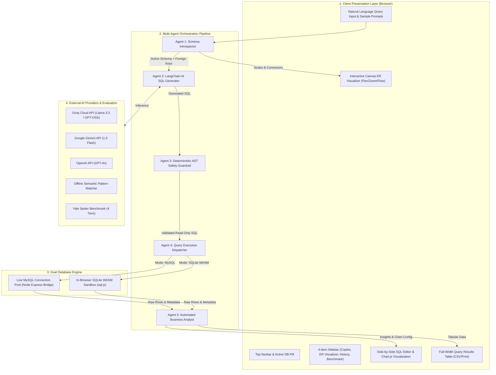
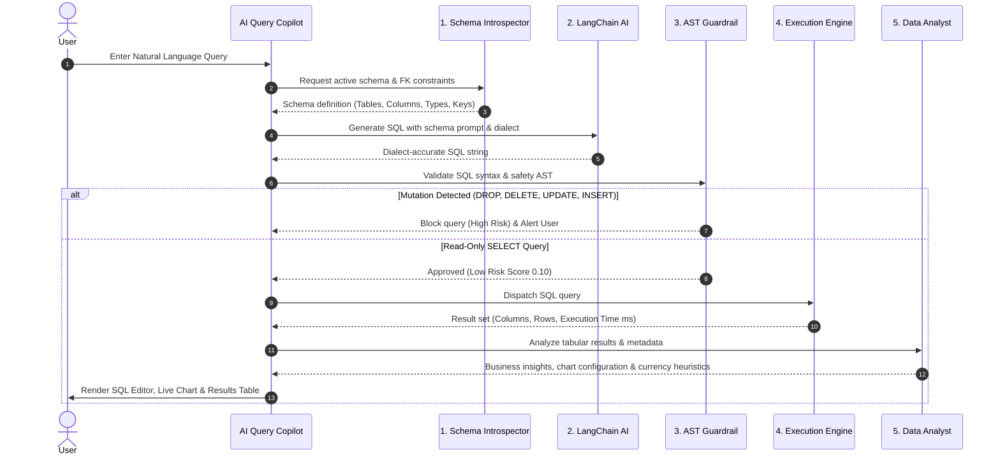

# SQLGenX: End-to-End System Architecture


## 1. Executive System Overview

**SQLGenX** is an enterprise-grade **Agentic AI SQL Generation, Data Analytics, and Entity-Relationship (ER) Intelligence Platform**. It enables data analysts, database administrators, and developers to explore relational data in plain natural language, introspect complex database schemas, generate dialect-accurate SQL queries with sub-millisecond execution, and visualize relationships both as an **interactive canvas graph** and a **tabular schema matrix**.

The platform is designed with a strict **zero-framework, lightweight frontend architecture** (HTML5, CSS3, Vanilla ES6 JavaScript, and Bootstrap 5.3) backed by a **dual database engine**:
1. **Realtime MySQL Connection Bridge**: Connects directly to local or cloud MySQL database servers.
2. **In-Browser SQLite WebAssembly (WASM) Sandbox**: 100% offline, zero-setup relational sandbox loaded with 1,900+ enterprise records.

---

## 2. High-Level System Architecture Diagram



---

## 3. Layer-by-Layer Architectural Breakdown

### Layer 1: Client Presentation Layer
- **HTML5 & Semantic Structure**: Accessible, clean document object model with zero compilation or JSX abstractions.
- **Restrained Dark Theme (Section 12 Design System)**:
  - Surface Background: `#060B16`
  - Sidebar Surface: `#091226`
  - Card Surface: `#0D172A`
  - Card Header & Input Surface: `#111E33`
  - Accent Colors: Electric Cyan (`#00D9FF`), Royal Blue (`#1677FF`), Emerald Green (`#10B981`), Amber (`#F59E0B`).
- **Typography Matrix**:
  - Headings & Branding: `Outfit` (700/800 font weights)
  - UI Controls & Body: `Plus Jakarta Sans` (400/500/600 font weights)
  - Code & SQL Editor: `JetBrains Mono` (400/600 monospace)
- **Responsive Layout**:
  - **Desktop (≥ 1200px)**: Fixed 240px left sidebar, 50/50 split for SQL Editor and Data Visualization, full-width Query Results below.
  - **Tablet (768px – 1199px)**: Sidebar converts into an offcanvas drawer with hamburger button (`#btn-sidebar-toggle`) and backdrop (`#sidebar-backdrop`).
  - **Mobile (< 768px)**: Vertically stacked panels, independent horizontal scrolling for SQL editor and tables, touch-friendly tap targets.

---

### Layer 2: Multi-Agent Orchestration Pipeline



#### 1. Schema Context & Introspection Agent (`js/database.js`)
- Dynamically extracts all tables, columns, data types, primary keys, and foreign keys from the active database.
- Constructs a concise prompt context containing table schemas and relational links so the LLM understands table relationships without hallucinating column names.

#### 2. LangChain AI SQL Generation Agent (`js/langchain-llm.js`)
- Orchestrates model routing across **Groq Cloud** (LLaMA 3.3, GPT-OSS 120B), **Google Gemini** (1.5 Flash), and **OpenAI** (GPT-4o).
- Enforces strict dialect targeting:
  - SQLite mode uses standard SQLite syntax and functions (`ROUND`, `STRFTIME`, `LIMIT`).
  - MySQL mode uses MySQL syntax (`NOW()`, backtick column quotes, `IFNULL`).
- Includes an **Offline Semantic Fallback** engine powered by fuzzy regex matching for instant offline query generation without API keys.

#### 3. Deterministic AST & Safety Guardrail Agent (`js/validator.js`)
- Performs token-level AST scanning for destructive SQL statements:
  `DROP`, `DELETE`, `TRUNCATE`, `ALTER`, `CREATE`, `UPDATE`, `INSERT`, `REPLACE`, `GRANT`, `REVOKE`.
- Computes deterministic risk scores:
  - **LOW RISK (0.10)**: Standard read-only `SELECT` with bounded constraints.
  - **MEDIUM RISK (0.45)**: Queries with multiple joins, Cartesian products, or missing `WHERE`/`LIMIT` clauses.
  - **HIGH RISK (0.90+)**: Attempted mutating queries (automatically blocked from execution).

#### 4. Query Execution Engine (`js/database.js` & `server.js`)
- **MySQL Path**: Transmits query over HTTP POST `/api/mysql/query` to the local Node.js Express bridge, which executes against the active MySQL connection pool and returns JSON records with sub-millisecond execution timings.
- **SQLite WASM Path**: Executes directly in the browser's JavaScript main thread via `sql.js` WebAssembly memory buffers with 0ms network latency.

#### 5. Automated Data Analyst Agent (`js/analyst.js`)
- Automatically inspects the column names and returned data types.
- Selects the optimal Chart.js visualization type:
  - Categorical dimension + numerical metric $\rightarrow$ **Bar Chart**
  - Time series dimension (`date`, `month`, `year`) $\rightarrow$ **Line Chart**
  - Proportional composition (< 6 categories) $\rightarrow$ **Doughnut / Pie Chart**
- Employs heuristic metric classification:
  - Columns matching `spending`, `revenue`, `price`, `cost`, `salary` $\rightarrow$ Formatted with currency indicators (`₹`).
  - Columns matching `marks`, `score`, `count`, `grade`, `gpa`, `percent`, `age` $\rightarrow$ Plain formatted numbers without currency symbols.

---

### Layer 3: Dual Database Engine Architecture

| Dimension | Realtime MySQL Connection | In-Browser SQLite WASM Sandbox |
|---|---|---|
| **Runtime Environment** | Node.js Server (`mysql2/promise`) | Client-side WebAssembly (`sql.js`) |
| **Network Requirement** | Localhost or remote MySQL IP (Port 3306) | 100% Offline (Zero external requests) |
| **Connection Pooling** | 10 concurrent connections with queue limit | In-memory WASM buffer instance |
| **Dataset Scale** | Real production tables (unlimited rows) | 1,900+ seeded records across 6 enterprise tables |
| **Introspection** | `information_schema.tables` & `key_column_usage` | SQLite `sqlite_master` & `PRAGMA foreign_key_list` |
| **Safety Enforcement** | Server-side regex & AST validation | Client-side AST validation |

---

### Layer 4: Interactive Canvas ER Visualizer Engine (`js/er-visualizer.js`)

The ER visualizer is an interactive canvas engine designed to eliminate the static limitations of traditional schema diagrams:

```text
┌────────────────────────────────────────────────────────────────────────┐
│ ER Visualizer Architecture                                             │
├────────────────────────────────────────────────────────────────────────┤
│ 1. Coordinate Transform:                                               │
│    Screen Coords ──[ - panX, - panY ]──▶ World Coords ──[ / scale ]──▶ │
│                                                                        │
│ 2. Spatial Node Model:                                                 │
│    Each Table Card = { x, y, width: 200, height: dynamic, userDragged }│
│                                                                        │
│ 3. Edge-to-Edge Bezier Auto-Anchors:                                   │
│    Calculates intersection of connector ray with card bounding box.   │
│    Prevents connector lines from cutting through table card text.     │
│                                                                        │
│ 4. Animated Marching Dash Flow:                                        │
│    Continuous requestAnimationFrame loop animates lineDashOffset.     │
│    Visualizes directional relationship flow (PK ──► FK).               │
│                                                                        │
│ 5. Auto-Fit Algorithm (zoomToFit):                                     │
│    Measures bounding box [minX, minY, maxX, maxY] of all nodes.       │
│    Calculates scale = Math.min(availW / diagW, availH / diagH).        │
│    Centers and scales diagram to fill 100% of viewport without gaps.  │
└────────────────────────────────────────────────────────────────────────┘
```

#### Canvas Interaction Capabilities
- **Infinite Pan**: Drag canvas background with `grabbing` cursor to navigate large schemas.
- **Focal Zoom**: Mouse wheel zoom centered directly at mouse pointer coordinates.
- **Node Repositioning**: Click and drag table cards with real-time connector rerouting.
- **Relationship Isolation**: Clicking a table node isolates its foreign-key network, dims unrelated tables, and renders linked table navigation chips in the status banner.
- **Direct Record Preview**: Double-clicking any table node immediately opens the live sample data preview modal without leaving the diagram.

---

### Layer 5: Yale Spider Benchmark Integration & Concrete Application Usage

The Yale University **Spider dataset** is utilized in SQLGenX across **three concrete, functional implementations**:

1. **Seeded In-Browser Sandbox Database (`js/database.js`)**:
   The built-in offline database runs the official Spider Store schema across 6 relational tables (`customers`, `categories`, `products`, `orders`, `order_items`, `payments`) populated with 1,900+ real records inside an in-browser SQLite WebAssembly memory buffer.
2. **Dynamic Prompt Grounding (`js/langchain-llm.js`)**:
   The Schema Agent extracts Spider foreign key links (e.g., `orders.customer_id ➔ customers.customer_id`) and passes them into the LLM system prompt, training models to write multi-table `JOIN` statements without schema hallucination.
3. **Interactive ER Graph Visualizer (`js/er-visualizer.js`)**:
   Directly maps this Spider schema onto an interactive HTML5 canvas with edge-to-edge Bezier connector rays and animated relationship flow.

#### Concrete Execution Example
When a user asks: *"Show the top 5 customers by total spending"*:
- **Schema Context**: Reads Spider tables `customers` and `orders` linked by `customer_id`.
- **AI SQL Output**:
  ```sql
  SELECT 
    c.first_name || ' ' || c.last_name AS customer_name,
    ROUND(SUM(o.total_amount), 2) AS total_spending
  FROM customers c
  JOIN orders o ON c.customer_id = o.customer_id
  GROUP BY c.customer_id, customer_name
  ORDER BY total_spending DESC
  LIMIT 5;
  ```
- **Validation**: AST validator approves as `LOW RISK (0.10)`.
- **Execution**: Runs in `1.42 ms` in SQLite WASM, returning ranked customer records.
- **Analytics & Visuals**: Chart.js renders a cyan-to-blue Bar Chart with direct value labels, and the ER Visualizer highlights the active `customers` ➔ `orders` connection link.

#### Spider Complexity Classification Tiers

| Tier | Required SQL Constructs | Target Schema Example |
|---|---|---|
| **Easy** | Single table, basic filters, simple `LIMIT` / `ORDER BY` | `SELECT name, price FROM products ORDER BY price DESC LIMIT 5` |
| **Medium** | 2-table `JOIN`, single aggregation (`SUM`, `AVG`), `GROUP BY` | `SELECT c.first_name, SUM(o.total_amount) FROM customers c JOIN orders o GROUP BY c.customer_id` |
| **Hard** | 3+ table `JOIN`, `GROUP BY ... HAVING`, date functions | Multi-table joins across `orders`, `order_items`, `products`, and `categories` |
| **Extra Hard** | Correlated subqueries, set operations (`UNION`, `INTERSECT`, `EXCEPT`), `NOT IN` | Complex customer attrition and cross-category purchasing analyses |

---

## 4. Component & File Directory Map

```text
SQLGenX/
├── index.html                   # Master HTML5 single-page application entrypoint
├── server.js                    # Node.js Express 5 API bridge for MySQL & static file serving
├── package.json                 # Dependency manifest (express, cors, mysql2)
├── requirements.txt             # System requirements & runtime prerequisites manifest
├── SPIDER_DATASET.md            # Yale Spider benchmark technical documentation
├── SYSTEM_ARCHITECTURE.md       # Comprehensive system architecture specification
├── README.md                    # Project overview, installation, and usage guide
│
├── assets/
│   └── system_architecture_diagram.png # Full-system architecture diagram
│
├── css/
│   └── style.css                # Section 12 design system, dark palette, canvas & responsive rules
│
└── js/
    ├── app.js                   # Application coordinator, event dispatcher & history state
    ├── database.js              # Dual database engine (MySQL connection pool & SQLite WASM sandbox)
    ├── er-visualizer.js         # Interactive Canvas ER graph, pan/zoom, auto-anchor & flow engine
    ├── langchain-llm.js         # LangChain AI agent, Groq/Gemini/OpenAI routing & offline fallback
    ├── validator.js             # Deterministic AST read-only guardrail & risk scoring engine
    └── analyst.js               # Data analyst agent & dynamic Chart.js chart generator
```

---

## 5. Security, Privacy & Safety Protocols

1. **Deterministic Read-Only Protection**:
   All user-supplied and AI-generated SQL queries pass through the AST validation engine before dispatch. Mutating statements (`DROP`, `DELETE`, `UPDATE`, `INSERT`, `ALTER`, `TRUNCATE`) are blocked client-side. The MySQL connection bridge additionally rejects mutating statements server-side as a secondary defense layer.
2. **Client-Side API Key Storage**:
   User API keys (Groq, Gemini, OpenAI) are saved exclusively in the user's browser `localStorage` and never transmitted to or logged by the SQLGenX backend server.
3. **Zero External Dependencies in Sandbox Mode**:
   When running on the in-browser SQLite WASM sandbox, all query parsing, execution, and rendering occur entirely in the local browser process.

---

## 6. Execution & Deployment

### Local Development
```bash
# 1. Install dependencies
npm install

# 2. Start server
npm start
# Server listens at http://localhost:3000
```

### Static Hosting (GitHub Pages)
Because SQLGenX's SQLite WASM engine, AI Copilot, and ER Visualizer operate 100% in client-side JavaScript, the entire application can be hosted on any static hosting provider (GitHub Pages, Vercel, Netlify) with zero server configuration. Live MySQL connectivity is enabled whenever the optional local Express bridge is running.
